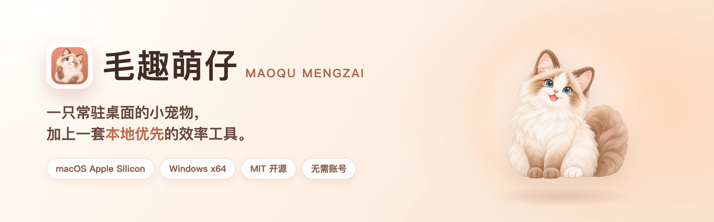
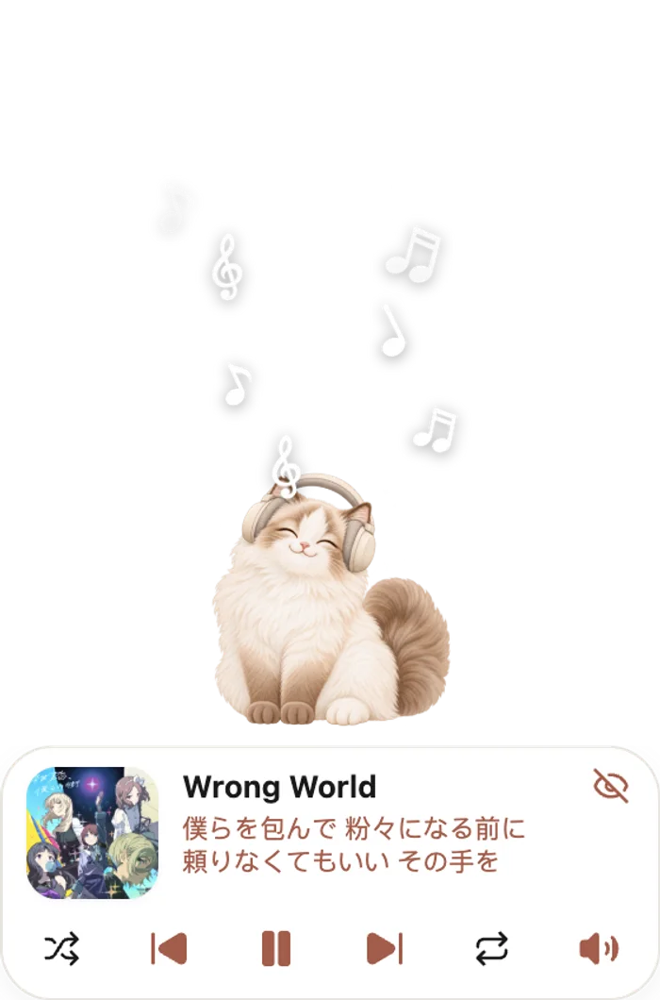
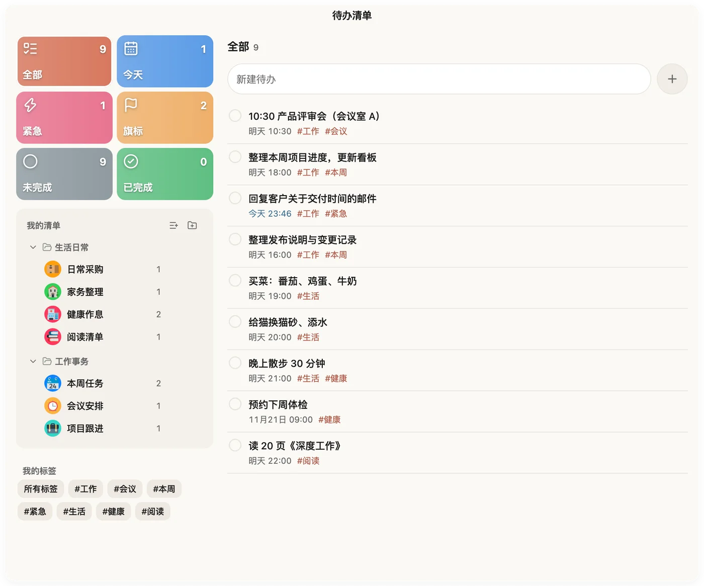
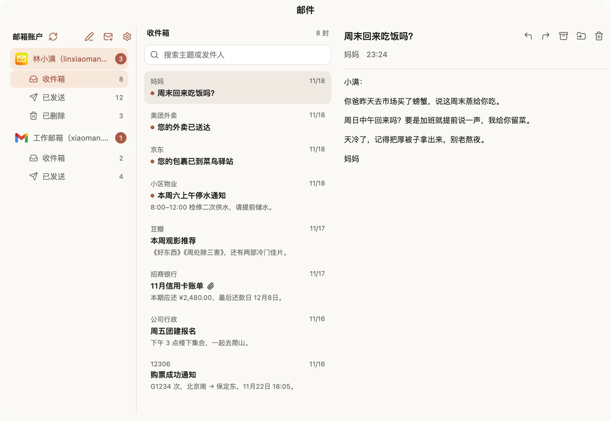
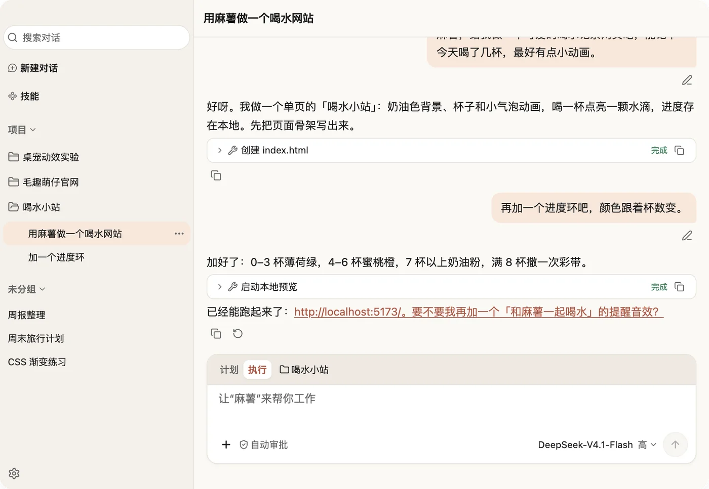
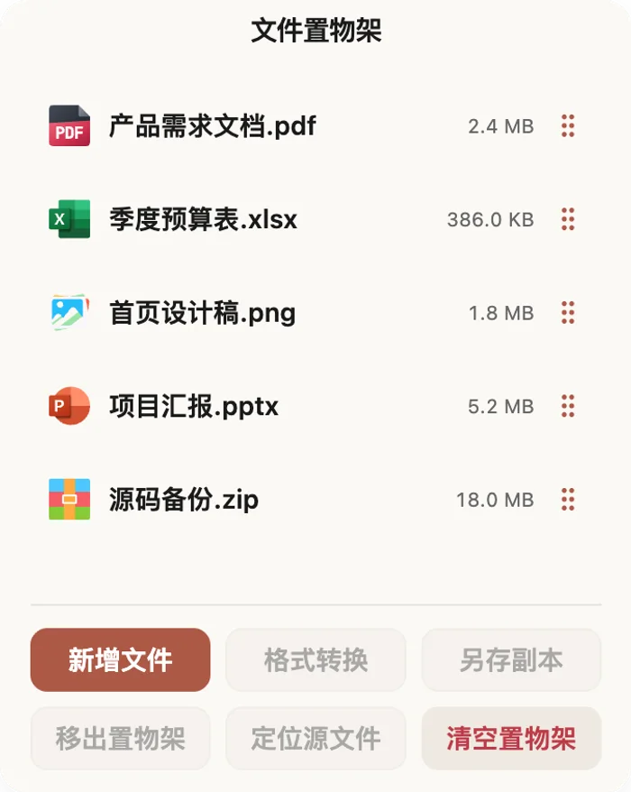
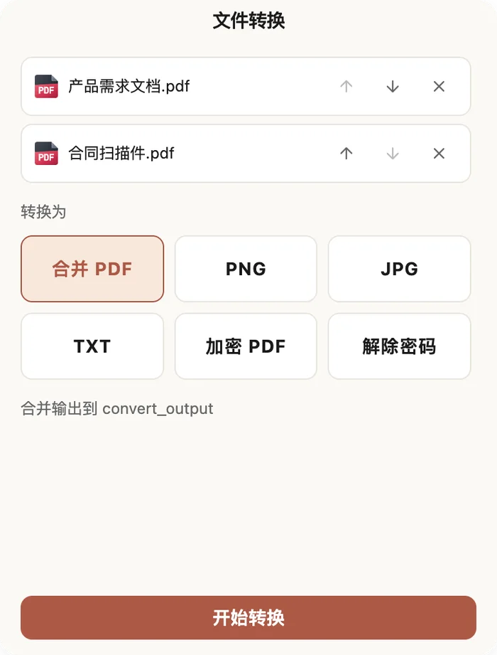

<div align="center">
  
</div>

<p align="center">
  <b>一只常驻桌面的小宠物，加上一套本地优先的效率工具。</b><br />
  番茄钟、提醒、待办、置物架、剪贴板、截图、格式转换、音乐控制与邮箱收发，都在本机完成。
</p>

<p align="center">
  <a href="https://mqmz.qimeistudio.com/"><b>官网与下载</b></a> ·
  <a href="CHANGELOG.md">更新记录</a> ·
  <a href="CONTRIBUTING.md">参与开发</a> ·
  <a href="docs/technical-architecture.md">技术方案</a> ·
  <a href="https://github.com/qimei-it/maoqumengzai-desktop-pet/issues">反馈问题</a>
</p>

<p align="center">
  <a href="https://github.com/qimei-it/maoqumengzai-desktop-pet/actions/workflows/ci.yml"></a>
  <a href="https://github.com/qimei-it/maoqumengzai-desktop-pet/releases"></a>
  
  
  <a href="LICENSE"></a>
</p>

<table>
  <tr>
    <td width="33%" valign="top">
      <b>数据留在本机</b><br />
      日常动画、提醒与工具不调用模型，也没有遥测或崩溃上报。你的待办、邮件与文件只存在本机。
    </td>
    <td width="33%" valign="top">
      <b>不需要账号</b><br />
      本地功能开箱即用。只有宠物档案云同步与交友广场需要绑定账户，且不在首个开源版本内。
    </td>
    <td width="33%" valign="top">
      <b>Electron + Vue</b><br />
      主进程负责窗口、托盘、提醒与格式转换，渲染层是一个 Vue 3 单页应用，按需懒加载每个面板。
    </td>
  </tr>
</table>

## 桌面上的那个小可爱

<p align="center">
  
</p>

桌宠常驻桌面、始终置顶，可以缩放与拖动。它有待机、拖动、听歌、思考与专注几种姿态，会眨眼、呼吸，跟着音乐轻轻晃。打开面板时它仍在最上层，但不会被面板盖住。

- **音乐**（仅 macOS）：QQ 音乐、网易云、Apple Music、酷狗的播放、切歌、进度与音量；歌词逐行滚动，可只留封面。
- **专注**：番茄钟的专注、短休、长休三阶段共用同一只桌宠，只有环形进度条的颜色不同。
- **宠物档案**：内置麻薯与所有自定义桌宠放在一起，点一下就能切换。

## 待办、提醒与时间



待办支持清单、分组、标签、截止时间与重复规则；窗口可以放大，双击标题栏铺满或恢复默认尺寸，清单与标签区按 2:1 跟随缩放。标签右键即可重命名或删除。

番茄钟与提醒共用同在屏幕角落的倒计时元素：喝水、久坐、护眼可以分别设置时段、间隔与免打扰；到点由桌宠提醒，也可走系统通知。

## 邮件与智能体

<table>
  <tr>
    <td width="50%" valign="top">
      <br />
      <b>邮件</b>：QQ、163、126、Gmail 的收件、正文、附件与发送，识别数字验证码并复制。
    </td>
    <td width="50%" valign="top">
      <br />
      <b>智能体</b>：自备 Key 的对话与工具调用，能操作本机的待办、置物架与转换，危险命令需要审批。
    </td>
  </tr>
</table>

## 置物架与格式转换

<table>
  <tr>
    <td width="50%" valign="top">
      <br />
      <b>文件置物架</b>：拖进来暂存，随时打开、定位或拖出副本，移出索引不动源文件。
    </td>
    <td width="50%" valign="top">
      <br />
      <b>格式转换</b>：图片、PDF、Office、OFD、影音与压缩包，内置 qpdf、FFmpeg、7-Zip 等引擎，离线可用。
    </td>
  </tr>
</table>

## 从源码构建

需要 Node.js 24 或更新版本，以及可用的图形桌面会话。

```sh
npm ci
node node_modules/electron/install.js
npm run dev
```

打包：

```sh
npm run pack:mac   # dist/mqmz-<version>-arm64.dmg
npm run pack:win   # dist/mqmz-<version>-setup.exe
```

`pack:mac` 在 macOS 上执行。Windows 安装包必须在 Windows 上构建：`sharp` 与 `@napi-rs/canvas` 的原生二进制按平台安装，在 macOS 上交叉打包会得到启动即崩溃的安装包。打包前 `npm run check:natives` 会校验目标平台的原生模块，打包后 `afterPack` 会再验一次并裁掉其他平台的二进制。

Windows 安装包由 GitHub Actions 在 `windows-latest` 上构建，工作流见 `.github/workflows/build-win.yml`。

`dist/latest.json`（应用内更新清单）会自动刷新：`pack:mac` / `pack:win` 在打包结束时检查 `dist/`，两个平台的安装包都在就重新生成清单，缺包则跳过（不会写出只有单平台的清单）。发版时打 tag 后，`.github/workflows/update-manifest.yml` 会从 Release 资产里取两个安装包，生成清单并挂回 Release。

其他常用脚本：

```sh
npm run typecheck        # vue-tsc
npm test                 # Vitest 单元测试
npm run test:e2e         # Playwright Electron 端到端
npm run check:design     # 设计 token 与组件规范
npm run check:contrast   # 对比度
npm run check:icons      # 图标来源
npm run update:manifest  # 生成 dist/latest.json；两个平台包齐全时才写，可加 --partial 只出单平台
```

## 应用内更新

客户端读取 `https://mqmz.qimeistudio.com/latest.json`，比对版本后下载对应平台的安装包，校验 SHA-256，再打开安装程序并退出：macOS 上由你把它拖进「应用程序」，Windows 上运行安装向导。下次启动时如果版本已经更新，客户端会把下载好的安装包移进废纸篓；没装成则保留，下次再说。

没有使用 Squirrel 式自动替换。清单生成见 `scripts/update-manifest.mjs`，发布步骤见 `docs/release/`。开发模式下（未打包）不检查更新。

## 数据与隐私

本地数据默认不上传，也没有遥测或崩溃上报。只有在你自己配置了第三方服务时，客户端才会直接连接对应服务。完整说明见 [隐私政策](docs/privacy-policy.md)。

本地数据位于 `~/Library/Application Support/mqmz-desktop`（macOS）或 `%LOCALAPPDATA%\mqmz-desktop`（Windows）。在「设置 → 数据」可以删除全部本地数据；卸载默认保留数据，Windows 卸载向导会询问是否一并删除，macOS 可在 DMG 中运行「卸载.command」按提示操作。

## 参与与安全

- 提交前请阅读 [CONTRIBUTING.md](CONTRIBUTING.md)：分支、提交信息、检查项与设计约束。
- 安全问题请按 [SECURITY.md](SECURITY.md) 私下报告，不要开公开 Issue。

## 许可

- 客户端代码：[MIT](LICENSE)
- 第三方组件、引擎、图标与素材：[THIRD-PARTY-NOTICES.md](THIRD-PARTY-NOTICES.md) 与 `resources/licenses/`

许可证只覆盖代码，不覆盖线上服务与用户数据。官方名称、官方服务与域名由运营方保留，第三方构建不代表获得官方服务授权。
