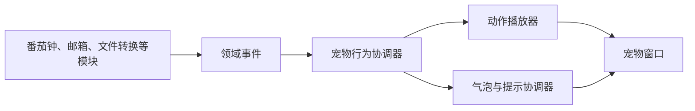

# OpenPets 架构与设计借鉴评估

核实日期：2026-11-09（Asia/Shanghai）。目标仓库：[OpenPetsHQ/openpets](https://github.com/OpenPetsHQ/openpets)，本次阅读默认分支的文档与关键源码。

## 结论

OpenPets 很适合补充为毛趣萌仔的桌宠运行时参考：Electron 进程边界、资源包协议、透明像素命中、显示器变化恢复、语义事件与动作映射、气泡协调，以及模块生命周期都与本项目直接相关。

建议按自己的需求独立实现这些基础设计。维持 Electron + Vue 3 + TypeScript、本地优先、既有小程序业务与 DeepSeek 双端会话等已确认方向。首版不新增第三方插件市场、编程 Agent 控制、远程控制、局域网宠物、换装或 Teams 企业业务。

本次是静态源码与文档评估，没有运行 OpenPets、安装它的插件、执行 CLI 或访问任何用户凭据，不构成本项目 Windows/macOS 的兼容性证据。

## 1. 进程与窗口边界

OpenPets 把主进程作为窗口、状态、生命周期与原生能力的所有者；宠物、Control Center、插件等渲染进程分别拿到受限的 preload bridge。应用以托盘为入口，控制中心按需打开，并采用单实例锁。

对本项目的建议：

- 主进程负责窗口、权限、系统凭据与服务生命周期；高频持久化和重型转换按需使用独立任务边界，避免全部阻塞主进程。
- 宠物窗口只接收绘制、状态、互动和必要的快捷卡片能力；工作台持有管理能力，两者不共享一个无限权限 bridge。
- 工作台关闭后常驻宠物继续运行；从托盘或宠物入口重新打开同一个工作台。
- 我们使用 Vue，借鉴结构，不迁移其 React/Tailwind 页面代码。

来源：[desktop.md](https://github.com/OpenPetsHQ/openpets/blob/main/docs/desktop.md)、[architecture.md](https://github.com/OpenPetsHQ/openpets/blob/main/docs/architecture.md)。

## 2. 宠物资源协议先于动画生产

OpenPets 将宠物描述、精灵图布局、动作映射与安装验证分开。它的布局文件定义单帧 192×208、每行 8 格，版本分别为 9 行与 11 行；可选活动使用独立动画条，声明帧数与帧率。

这是该项目的资源布局，不是本项目已经确定的画布尺寸，也不能直接当作 Codex 在用户屏幕上的实际显示大小。

建议毛趣萌仔先独立定义版本化资源包，包含：

- 角色标识、资源协议版本、包版本、默认动作与预览。
- 单帧尺寸、可见区域、脚底锚点，以及可选的注视锚点。
- 各动作的文件、帧数、播放时长或帧率、循环策略、方向及动作缺失时的回退。
- 文件校验和、总大小和可解码像素等限制。
- 默认宠物和用户专属宠物使用同一协议；性格参数与图像资源分开，便于复用渲染器。

首版只有两只无衣物角色，不纳入 wardrobe 字段和换装调度。也不要求每个生成结果都必须一次成功填满大型动作图集；固定必需动作与可选动作的回退规则更适合逐步验证生产流程。

来源：[宠物说明](https://github.com/OpenPetsHQ/openpets/blob/main/docs/pets.md)、[布局定义](https://github.com/OpenPetsHQ/openpets/blob/main/packages/pet-format/src/sprite-layout.ts)、[metadata.ts](https://github.com/OpenPetsHQ/openpets/blob/main/packages/pet-format/src/metadata.ts)。

## 3. 业务事件、动作与气泡分层

OpenPets 使用语义 reaction，再映射为动画与预设文案，而不是让每个业务模块直接操纵精灵图坐标。闲置动作有等待、冷却和避免连续重复的策略。

建议业务模块只发送自己的领域事件，由宿主映射成展示意图。例如：

这是一套建议结构，不是引用 OpenPets 已有的同名完整管线。

- 同一个转换完成事件，布偶猫与柯基可以映射不同动作，无须修改转换服务。
- 用户拖动、投递文件和主动互动优先；背景提醒受免打扰、冷却与去重约束。
- 活泼、黏人等性格影响概率、节奏和动作选择，不给予模型本机操作权限。
- 日常行为和预设提示均本地驱动，不消费用户 DeepSeek Key。

来源：[animation.ts](https://github.com/OpenPetsHQ/openpets/blob/main/packages/pet-format/src/animation.ts)、[闲置活动策略](https://github.com/OpenPetsHQ/openpets/blob/main/apps/desktop/src/pet-activity-policy.ts)。

## 4. 透明像素命中与故障恢复

OpenPets 的命中判定会把鼠标坐标映射到当前动画帧，考虑缩放与水平翻转，按 alpha 判断是否点到主体，减少透明角落与淡阴影吞掉底层点击。像素不可用时优先保持可交互，避免宠物彻底无法抓取。

它还针对鼠标事件转发失效做恢复，并集中协调显示器插拔、显示参数变化与睡眠唤醒。

对本项目的建议：

- 普通悬停/点击采用主体命中，而不是让整个透明矩形都阻挡桌面。
- 文件拖入是不同交互模式：应临时显示更容易投递的接收区域，不要求用户精确命中毛发像素。
- 测试动画帧切换、缩放、翻转、多屏、Space/全屏和唤醒后的可拖动性。
- 预留托盘恢复位置与交互的入口；缓存大小和探测频率按我们的性能预算制定，不复制参考项目的常量。

来源：[alpha 命中源码](https://github.com/OpenPetsHQ/openpets/blob/main/apps/desktop/src/pet-alpha-hit-test.ts)、[交互恢复源码](https://github.com/OpenPetsHQ/openpets/blob/main/apps/desktop/src/pet-window-interaction.ts)、[显示协调器](https://github.com/OpenPetsHQ/openpets/blob/main/apps/desktop/src/pet-display-coordinator.ts)。

## 5. 气泡协调与提示设计

OpenPets 的气泡协调器将临时气泡与固定气泡分槽，处理优先级、队列上限、相邻重复内容与关闭回调。宿主负责显示与交互，功能模块提交描述，不向宠物窗口注入任意页面。

本项目的饮水、休息、番茄钟、交友、邮件、验证码和转换都可能同时提示，建议第一版就设一个统一提示出口：

- 决定当前展示什么，哪些等待、合并、延后或仅记入工作台。
- 固定任务进度与短暂完成反馈分开；展开聊天时减少重复气泡。
- 验证码使用专用的本地大号数字卡与复制动作，不以普通日志或全量通知正文传播。
- 一个业务事件的提示关闭不等于取消后台任务；任务生命周期与展示生命周期分开。

来源：[plugin-bubble-arbiter.ts](https://github.com/OpenPetsHQ/openpets/blob/main/apps/desktop/src/plugin-bubble-arbiter.ts)、[宠物展示说明](https://github.com/OpenPetsHQ/openpets/blob/main/docs/pets.md)。

## 6. 模块化能力与可验证生命周期

OpenPets 插件通过声明式能力、权限检查和宿主 bridge 获取存储、调度、提示等能力，并提供不依赖真实网络、真实时钟与用户数据的测试工具。

毛趣萌仔首版可以先采用内部模块，无需实现公开 SDK 或插件市场。每个模块应明确启动/停止、配置、数据归属、系统权限、网络目标与事件；关闭模块时取消任务和监听。宿主统一提供通知、调度、密钥读取与数据清理入口。

把计时、免打扰、冷却、并发状态与清理规则拆成可注入时钟的纯逻辑，验证它们的实际业务结果；原生窗口、收件、播放器和订阅额度仍须真实环境验收。

来源：[插件架构](https://github.com/OpenPetsHQ/openpets/blob/main/docs/plugins.md)、[测试工具](https://github.com/OpenPetsHQ/openpets/blob/main/packages/sdk/src/testing.ts)、[验证层次](https://github.com/OpenPetsHQ/openpets/blob/main/docs/testing-and-validation.md)。

## 7. 工作台的视觉与交互设计

OpenPets 的设计文档把宠物的趣味性与控制中心的信息可读性结合，采用明确的语义颜色、统一控件、列表/详情分区、局部滚动和固定操作区域。

适合借鉴的部分是信息组织：宠物与动画预览、左侧列表/右侧详情、清楚的安装/启用/错误状态，以及不会因为宠物缩小而失去可读性的独立面板字号。

具体蓝色玻璃外观、品牌素材、React 组件、衣柜和目录分类不属于本项目必须采用的内容。默认麻薯沿用当前美术风格；柯基与自定义宠物后续，不再固定 2.5D 像素风。工作台使用自己的品牌与中文交互。

来源：[DESIGN.md](https://github.com/OpenPetsHQ/openpets/blob/main/DESIGN.md)。

## 8. 不直接迁入的范围与原因

| 参考项目能力或选择 | 本项目处理 |
| --- | --- |
| 第三方插件市场与完整 SDK | 暂以内部模块实现，避免增加安装、权限、兼容与审核范围 |
| MCP、编程 Agent hooks、远程控制、LAN 宠物、Teams | 非本项目首版需求，不追加服务或自动修改其他客户端配置 |
| 换装、衣柜与定时服装 | 用户明确首版不做 |
| 多个额外宠物窗口与 agent lease | 当前以一个活跃桌宠与角色切换为实现起点，后续需求另定 |
| 全部设置和状态使用 JSON | 配置可用小文件；邮件/剪贴板/任务等大量数据应单独评估 SQLite，密钥使用系统凭据能力 |
| 纯本地聊天及多模型 provider 平台 | 保留我们已确定的 DeepSeek 自备 Key 与双端独立会话，按同步白名单处理 |
| 资源尺寸、缓存上限、持续运动时钟、默认权限等常量 | 作为评估材料，不等于我们已经确认的指标或参数 |

OpenPets 自身的代码许可证是 MIT；实际依赖、角色素材及下载内容仍需分别检查。本项目遵守用户的独立实现与 mqmz 命名要求，修改名字不构成独立实现，也不能替代保留应有的来源与许可声明。

来源：[OpenPets LICENSE](https://github.com/OpenPetsHQ/openpets/blob/main/LICENSE)。

## 9. 建议加入 P0 技术方案的输出

1. 进程、窗口、服务生命周期与分开的 preload/IPC 边界。
2. 毛趣萌仔自己的宠物资源包协议和验证规范。
3. 业务事件→展示意图→动作/气泡的协调规则。
4. 普通点击、抚摸、拖动与文件投递的交互模式区分。
5. 显示器变化、唤醒、鼠标穿透异常的恢复验证矩阵。
6. 内部模块清单、调度/存储/凭据能力与真实验收边界。

本报告独立新增，不修改正在推进的 P0 进度、支持矩阵或需求交接文件；不将建议自动标记为用户已确认的新需求。
